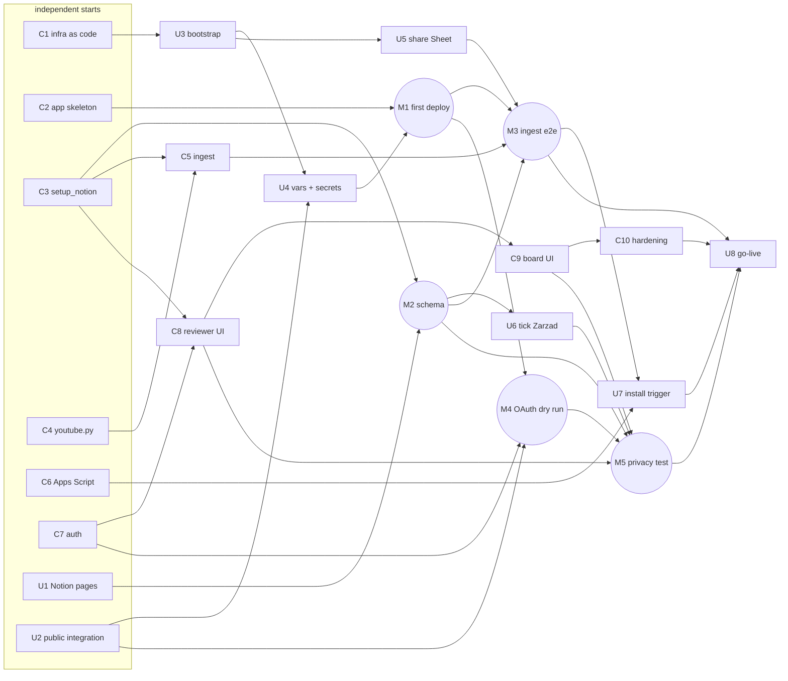

# Panel oceny kandydatów 2026 — specification

Status: C1–C10 merged to `main` (PR #2) and deployed 2026-10-12; M1–M4, U6 and U7 done; M5 (on
production, at go-live) and go-live open. Progress in §8.1, deviations from this text in §8.2.
Decisions so far: Notion workspace is on **Plus** → web app with Notion login (the only way to hide
reviewers' grades from each other on Plus). Hosting: **Cloud Run** in GCP project `theatre-sgh`
(billing attached 2026-10-12, 40 PLN/month budget alert in place). All code lives in GitHub
(`sigmagrindsetter/theatre-sgh`, public) and reaches GCP **only through GitHub Actions**; see §6.

## 1. Goal and requirements

| # | Requirement | How it is met |
|---|---|---|
| R1 | Source = Google Form; new answers appear without manual work | Ingest endpoint in the app, called by an Apps Script `onFormSubmit` trigger (seconds) and by Cloud Scheduler every 10 min (safety net) |
| R2 | Submitted answers are immutable | Ingest is create-only, keyed by e-mail; candidate fields are never updated |
| R3 | Fields textual; YouTube link rendered as a player; face screenshot nice-to-have | App embeds `youtube-nocookie.com/embed/<id>`; Notion page gets a `video` block; YouTube thumbnail stored as `Zdjęcie` + page cover |
| R4 | Candidate data read-only for reviewers | App renders candidates read-only; reviewers have no Notion access to the databases (both live in the restricted subpage) |
| R5 | Access only for Notion group "Aktywni Członkowie", via Notion login | Sign in with Notion (public integration OAuth); authorisation = Members DB row with `Person` = user and `Aktywny członek` ✓ |
| R6 | Per reviewer: comment + integer grade 1–10 per candidate | Ten grade buttons + textarea; server validates `1 ≤ ocena ≤ 10` |
| R7 | Reviewers never see others' grades/comments | Both databases live in the subpage "Ściśle tajne" whose inherited access is **removed** for reviewers (Zarząd group + integration only); the app returns rows filtered by the session user |
| R8 | Return to own input; autosave | Debounced `PUT /api/oceny/<id>` 1.5 s after the last change; reopening restores the row |
| R9 | "Zarząd" gets per-reviewer detail and per-candidate average | Notion-native views: Oceny grouped by Oceniający / by Kandydat, Kandydaci sorted by rollup `Średnia` + app page `/zarzad` with CSV |
| R10 | In code, Notion wherever possible | Notion is the only data store; the app is a thin permission-enforcing UI; infra and Notion schema are scripts in the repo |

Answered product decisions: `Zarząd` = checkbox in Lista członków; the page "Rekrutacja X 2026" is shared with all reviewers
and holds the panel **link only** (no iframe); YouTube thumbnail is the face shot; submissions whose video field
is not a YouTube/Drive URL are **skipped** (listed for the board), dedupe key = e-mail of the first
row with a valid link; reviewers see a progress table (counts only).

## 2. Verified facts the design depends on

- Form "Rekrutacja do Teatru SGH": name, e-mail (self-typed), university, year, areas, video link.
  Linked Sheet `SHEET_ID` in `config.py` is **reused from 2025** (20 old rows) → ingest filters
  `Sygnatura czasowa >= 2026-09-01`. Sheet headers carry trailing spaces (see old `COLUMN_MAPPING`
  in git history, commit `6755c43` and earlier).
- Video field across 26 rows: `youtu.be/ID` 14, `/shorts/ID` 8, `watch?v=ID` 1, Drive folder 1,
  free text 2. Tracking junk `?si=`, `?is=`, `?feature=shared`.
- YouTube `i.ytimg.com/vi/<id>/maxresdefault.jpg` (fallback `hqdefault.jpg`) is public, works for
  Shorts IDs. Notion `video` block accepts only `watch?v=`/`embed/` URLs.
- Members DB "Lista członków" `18a3f4160a3780c884bcd88c8e0c49b7`: `Person` (people),
  `Aktywny członek` (checkbox, 27 ✓, all with Person). No `Zarząd` property yet.
- Notion on Plus: no API/MCP to share pages or read groups; row/column access rules are
  Business/Enterprise; undocumented permissions endpoint returns "Endpoint is not available".
  Hence the server-side boundary. OAuth token exchange returns `owner.user` (id, name,
  `person.email` with the "user information with email" capability). Notion API 2026-03-11.
- Cloud Run: deterministic URL `https://<service>-<project-number>.<region>.run.app`
  (project number `590133883335`), so the OAuth redirect URI is known before the first deploy.
  Free tier 2 M requests / 180 k vCPU-s / 360 k GiB-s per month; `europe-west1` is Tier 1.
- Apps Script consumer quotas: 20 000 UrlFetch/day, 6 min per execution — far above our load.
- The internal integration `theatre-sgh` (token `NOTION_API_TOKEN`) already exists and is in
  GitHub secrets; service account `integrator@theatre-sgh.iam.gserviceaccount.com` has project
  `roles/editor` (too broad for a public web app → dedicated runtime SA, §6).
- The responses Sheet is owned by a member (not teatr.sgh) and is shared **"anyone with the link: can
  edit"**. The panel only reads it, but anyone who finds the link can alter submissions; worth
  switching to restricted sharing before the review window (owner's decision).

## 3. Architecture

```
Google Form ─▶ Sheet ──(ADC, Sheets API)──▶ Cloud Run service "panel-rekrutacja" (FastAPI)
  Apps Script onFormSubmit ──POST /internal/ingest (X-Ingest-Token)──▶   │  bot token (NOTION_API_TOKEN)
  Cloud Scheduler every 10 min ──POST /internal/ingest (OIDC)──▶        │
                                                                        ▼
Reviewer ─▶ Notion page "Rekrutacja X 2026" (link + instructions only) ─▶ app ─▶ Sign in with Notion (identity only)
                                                 │     Notion page "Rekrutacja X 2026"  (Aktywni Członkowie: Can view, Zarząd: Full, + integration)
                                                 │     └── Zarząd (subpage, reviewers' inherited access REMOVED: Zarząd group + integration)
                                                 ├──▶       ├── Kandydaci (DB)  create-only by ingest, read by app
                                                 ├──▶       └── Oceny (DB)      upsert by app, filtered per user
                                                 └──▶  Lista członków       authz (Aktywny członek, Zarząd)
Zarząd ─▶ native views on Oceny / Kandydaci (rollup average)   and   app /zarzad (+ CSV)
GitHub (main) ─▶ Actions: test → build image → push Artifact Registry → deploy Cloud Run (WIF, no keys)
```

- **One deployable**, request-based billing, `--min-instances 0` (cold start 2–4 s, mitigated with
  `--cpu-boost`), `--max-instances 1` (serialises ingest; ample for ≤30 users), 1 vCPU / 512 MiB,
  concurrency 80, region `europe-west1`. Optional `--min-instances 1` during the 2-week window
  (≈ 4.50 USD per two weeks) via repo variable `PANEL_MIN_INSTANCES`.
- **Stateless**: Notion is the only store. In-process caches: Members (5 min), Kandydaci (60 s).
- **Secrets** in Secret Manager, mounted as env vars; values enter via GitHub secrets (§6.3).

## 4. Data model (Notion)

Two pages, created by the board in the Notion UI (the API can neither create top-level pages nor
set sharing):

- **"Rekrutacja X 2026"** (top level): shared with group *Aktywni Członkowie* → **Can view**, group
  *Zarząd* → **Full access**, integration `theatre-sgh` connected. Holds only a callout with the
  panel link, instructions and the timeline. No data lives here: the app is the reviewers' single
  window on candidates, so there is nothing for them to browse in Notion.
- **"Ściśle tajne"** (subpage of the above; the spec earlier called it "Zarząd"): Notion's rule is "a subpage takes on the permissions of its
  parent page; to change this, go into the subpage and update the permissions there" (help centre,
  no plan restriction). So: open the subpage → *Share* → on the inherited *Aktywni Członkowie* entry
  choose **Remove** (Notion then marks the page *Restricted*); keep the Zarząd group and the
  integration. Holds **both** databases, Kandydaci and Oceny. This is the only way on Plus to hide
  a child from the parent's audience, and M5 verifies it with a real non-board account.

Both page IDs are configured (`PARENT_PAGE_ID`, `BOARD_PAGE_ID`), so a rename of either page is
harmless. `setup_notion.py` checks that the board page is readable and is a child of the parent
(an unreadable board page means the integration lost its connection when the page was
restricted; reconnect it), then creates Kandydaci and Oceny under the board page, idempotently by
title. The app resolves the database IDs at start-up from the board page.

Created by the user 2026-10-12, both connected to the integration (verified readable via API):

| Page | ID | Sharing (set in UI, not verifiable via API) |
|---|---|---|
| Rekrutacja X 2026 | `3f73f4160a3780f5afc1d195032e5501` | reviewers + board |
| Ściśle tajne | `3f73f4160a37806b8fa9feb5cfdb083b` | board only (confirmed in M5 with a non-board account) |

**Kandydaci** (one row per accepted submission)

| Property | Type | Source |
|---|---|---|
| Imię i nazwisko | title | form |
| Email | email | form, lower-cased; **unique key** |
| Czas | date | `Sygnatura czasowa` |
| Uczelnia, Rok studiów, Obszary | rich text, select, multi-select | form |
| Filmik | url | raw value |
| Filmik znormalizowany | url | `https://www.youtube.com/watch?v=<id>` or the Drive URL |
| Status filmiku | select: youtube / drive | set by ingest |
| Zdjęcie | files | thumbnail via File Upload API; also page cover |
| Oceny | relation → Oceny (two-way) | |
| Średnia, Liczba ocen | rollup (average / count of `Ocena`) | board "ranking" view; safe because reviewers never see this DB |

Page body: `video` block (YouTube) or `embed` block (Drive), then a paragraph with the raw link.

**Oceny** (one row per reviewer × candidate, created on first save)

| Property | Type | Notes |
|---|---|---|
| Nazwa | title | `<Kandydat> — <Oceniający>` |
| Kandydat | relation → Kandydaci (two-way, synced with `Oceny` above) | |
| Oceniający | people | Notion user from the session |
| Ocena | number | app enforces integer 1–10; empty allowed |
| Komentarz | rich text | ≤ 2000 chars (Notion rich-text limit) |
| Ostatni zapis | date | set on every save |
| Klucz | rich text | `<candidate_id>|<user_id>`, upsert key |

**Lista członków**: add checkbox **`Zarząd`** (setup script adds the property; the board ticks it).

## 5. Application

Stack: Python 3.11, FastAPI, Jinja2 templates, ~150 lines of vanilla JS, `itsdangerous` signed
cookie, `notion-client` with the existing `RetryingTransport`, `gspread` via Application Default
Credentials (small change in `shared/auth.py`: fall back to `google.auth.default()` when
`GOOGLE_PRIVATE_KEY` is absent).

| Route | Who | Behaviour |
|---|---|---|
| `GET /auth/login` | anyone | redirect to `api.notion.com/v1/oauth/authorize?owner=user&state=<csrf>` |
| `GET /auth/callback` | anyone | exchange code; keep `owner.user.id/name/email`, discard tokens; look up Members DB; set cookie (30 d, HttpOnly, Secure, SameSite=Lax); 403 page if not an active member |
| `POST /auth/logout` | session | clear cookie |
| `GET /` | reviewer, board | candidate list (thumbnail, name, areas, year, own status), progress table (graded/total per reviewer, counts only) |
| `GET /k/{id}` | reviewer, board | read-only candidate card, player, ten grade buttons, textarea, "Zapisano HH:MM" |
| `PUT /api/oceny/{id}` | reviewer, board | JSON `{ocena: int|null, komentarz: str}`; upsert by `Klucz`; `Oceniający` always = session user; 422 on out-of-range |
| `GET /zarzad`, `GET /zarzad/export.csv` | board only | per-reviewer detail, per-candidate averages, progress, skipped submissions (no valid link) |
| `POST /internal/ingest` | Apps Script (`X-Ingest-Token`) or Scheduler (Google OIDC token, `email` = runtime SA) | run ingest; returns counts; serialised by an in-process lock |
| `GET /health`, `GET /healthz` | anyone | 200; on the run.app URL only `/health` reaches the app (§8.2) |
| `GET /privacy`, `GET /terms` | anyone | static pages required by Notion's public-integration form |

Ingest algorithm: read sheet → keep rows with `Sygnatura czasowa >= CUTOFF` → parse video field
(`watch?v=`, `youtu.be/`, `/shorts/`, `/embed/` → 11-char id; `drive.google.com` → drive; else
skip) → group by lower-cased e-mail, first row with a valid link wins → for e-mails not yet in
Kandydaci: create page with properties + body, fetch thumbnail, File Upload → `Zdjęcie` + cover.
Skipped rows are not stored; `/zarzad` recomputes them from the sheet on demand.

Security: CSRF via `state` + SameSite cookie + `Sec-Fetch-Site: same-origin` check on `PUT`;
per-user rate limit on `PUT` (coalesced per candidate); comments never logged; bot token only on
Cloud Run; reviewers have no Notion access to `Kandydaci`/`Oceny` (restricted subpage); `/zarzad` double-gated (app
check + Notion sharing of the parent page). Consent-screen UX (template vs page picker) was decided
after the OAuth dry run (M4): page picker (§9 item 1).

## 6. Delivery pipeline and deployment rules

### 6.1 Rules
1. **Every change reaches GCP from GitHub Actions on `main`.** The only identity able to deploy is
   `panel-deployer@theatre-sgh.iam.gserviceaccount.com`, reachable solely via Workload Identity
   Federation from repository `sigmagrindsetter/theatre-sgh`, ref `refs/heads/main`. No key file
   exists for it.
2. No `gcloud run deploy`, `gcloud builds submit`, `docker push`, or Secret Manager writes from a
   workstation. Notion schema setup also runs in Actions (`panel-setup.yml`).
3. **Single exception, needs your explicit go each time:** the one-time bootstrap of IAM/APIs
   (§6.2) requires project-owner rights. Preferred execution: you run it in **Cloud Shell** from a
   fresh clone of the repo (nothing leaves a laptop). Alternative: I run it locally after you say so.
4. Secrets enter GitHub (repo secrets) and are pushed to Secret Manager by `panel-secrets.yml`.

### 6.2 Bootstrap (`apps/recruitment/infra/bootstrap.sh`, idempotent)

**Executed 2026-10-12** from the workstation as `teatr.sgh@gmail.com`, on the user's explicit request
("do them please"); dry run reviewed first. Re-running is safe (idempotent) and is the only
sanctioned local→GCP action. Everything from here on goes through GitHub Actions.

| Resource | Detail |
|---|---|
| APIs | run, artifactregistry, secretmanager, iam, iamcredentials, sts, cloudscheduler, cloudresourcemanager |
| Artifact Registry | repo `panel` (Docker, `europe-west1`), cleanup policy keep last 5 images |
| SA `panel-runtime` | no project roles; `roles/secretmanager.secretAccessor` on the 5 secrets |
| SA `panel-deployer` | `roles/run.admin`; `roles/artifactregistry.writer` on repo `panel`; `roles/iam.serviceAccountUser` on `panel-runtime`; `roles/secretmanager.secretVersionManager` on the 5 secrets; `roles/cloudscheduler.admin` |
| WIF | pool `github`, OIDC provider `theatre-sgh`, issuer `https://token.actions.githubusercontent.com`, mapping `google.subject=assertion.sub, attribute.repository=assertion.repository, attribute.ref=assertion.ref`, condition `assertion.repository == 'sigmagrindsetter/theatre-sgh' && assertion.ref == 'refs/heads/main'`; `panel-deployer` gets `roles/iam.workloadIdentityUser` for `principalSet://…/attribute.repository/sigmagrindsetter/theatre-sgh` |
| Secrets (empty) | `NOTION_API_TOKEN`, `NOTION_OAUTH_CLIENT_ID`, `NOTION_OAUTH_CLIENT_SECRET`, `SESSION_SECRET`, `INGEST_TOKEN` |
| Output | prints `GCP_WIF_PROVIDER` and `GCP_DEPLOYER_SA` to put into GitHub repo variables |

### 6.3 GitHub Actions workflows

| Workflow | Trigger | Steps |
|---|---|---|
| `panel-deploy.yml` | push to `main` touching `apps/recruitment/**`, `shared/**`, workflow; `workflow_dispatch` | `pytest` → auth (`google-github-actions/auth@v3`, WIF + `panel-deployer`) → `docker build -f apps/recruitment/Dockerfile .` → push `europe-west1-docker.pkg.dev/theatre-sgh/panel/panel-rekrutacja:<sha>` → `google-github-actions/deploy-cloudrun@v3` (`secrets:` mapping, `env_vars`, `flags: --service-account panel-runtime --min-instances ${{ vars.PANEL_MIN_INSTANCES }} --max-instances 1 --cpu 1 --memory 512Mi --concurrency 80 --cpu-boost --allow-unauthenticated`) → ensure Scheduler job `panel-ingest` (`*/10 8-23 * * *`, Europe/Warsaw, OIDC as `panel-runtime`, audience = service URL) → smoke `GET /health` |
| `panel-secrets.yml` | `workflow_dispatch` | add a new version of each of the 5 secrets from GitHub secrets, destroy older versions (disabled versions are billed as active, so only destroying stays within the 6 free versions) |
| `panel-setup.yml` | `workflow_dispatch` | run `setup_notion.py` with `NOTION_API_TOKEN` |

Permissions: `contents: read`, `id-token: write`. Deploy URL: `https://panel-rekrutacja-590133883335.europe-west1.run.app`.

### 6.4 Configuration

| Name | Where | Value |
|---|---|---|
| `GCP_WIF_PROVIDER`, `GCP_DEPLOYER_SA`, `PANEL_MIN_INSTANCES` | GitHub variables | from bootstrap; `0` (set `1` during the window) |
| `NOTION_API_TOKEN` (exists), `NOTION_OAUTH_CLIENT_ID`, `NOTION_OAUTH_CLIENT_SECRET`, `SESSION_SECRET`, `INGEST_TOKEN` | GitHub secrets → Secret Manager | OAuth pair from the Notion integration page; the two random ones generated by `openssl rand -hex 32` |
| `PARENT_PAGE_ID`, `BOARD_PAGE_ID`, `MEMBERS_DATABASE_ID`, `SHEET_ID`, `SHEET_NAME`, `CUTOFF_DATE`, `BASE_URL`, `SCHEDULER_SA_EMAIL` | `config.py` (overridable by env) | `3f73f4160a3780f5afc1d195032e5501` / `3f73f4160a37806b8fa9feb5cfdb083b` from U1; `2026-09-01`; the run.app URL |

### 6.5 Cost (2 weeks, verified prices)
Scale-to-zero: **0 USD** (≈30 k requests ≈ 3 % of the free CPU tier; egress < 1 GiB ≈ 0.12 USD).
With one warm instance: ≈ **4.50 USD**. Scheduler 1 of 3 free jobs; Secret Manager 5 of 6 free
versions; Artifact Registry < 0.5 GB; Logging < 50 GiB. Budget alert 40 PLN/month is active.

## 7. Repository layout (target)

```
apps/recruitment/
  REVIEW_PANEL_SPEC.md       this file
  config.py                  IDs, cutoff, URLs (rewritten)
  requirements.txt           runtime deps of the image (fastapi, uvicorn, jinja2, itsdangerous, httpx, notion-client, gspread, google-auth)
  Dockerfile                 python:3.11-slim, copies shared/ + apps/recruitment/, uvicorn on $PORT
  setup_notion.py            idempotent schema (Kandydaci, Oceny, Zarząd checkbox)
  infra/bootstrap.sh         §6.2
  apps_script/Code.gs        onFormSubmit → POST /internal/ingest; README with the 3 install steps
  panel/
    main.py                  app factory, routes, templates
    auth.py                  OAuth, session cookie, authorisation from Members DB
    store.py                 Notion access: candidates, grades (always user-scoped), members, caches
    ingest.py                sheet → Kandydaci
    youtube.py               link normaliser, thumbnail fetch
    templates/ static/
  tests/                     normaliser, dedupe/cutoff, authz, privacy filter, ingest idempotency (mocked Notion)
.github/workflows/panel-deploy.yml, panel-secrets.yml, panel-setup.yml
shared/auth.py               ADC fallback for Google credentials
```

Removed 2026-10-12 as obsolete (2025 design, broken evaluator filter): `apps/recruitment/sync.py`,
`cleanup_duplicates.py`, workflows `recruitment-sync.yml`, `recruitment-cleanup.yml`.
`sync-all.yml` never included recruitment and is unaffected.

## 8. Work breakdown with dependencies

Owner **C** = code (me, via PRs to `main`); **U** = you (Notion UI, GCP console/Cloud Shell,
GitHub settings); **M** = milestone / verification. "Parallel" lists tasks that can run at the same
time. Effort in days.

| ID | Task | Owner | Prerequisites | Parallel with | Effort | Done when |
|---|---|---|---|---|---|---|
| C1 | Infra as code: `bootstrap.sh`, `Dockerfile`, `panel-deploy.yml`, `panel-secrets.yml`, `panel-setup.yml` | C | — | C2 C3 C4 C6 C7 U1 U2 | 0.5 | Files reviewed in a PR; `bootstrap.sh --dry-run` prints the plan |
| C2 | App skeleton: FastAPI app, `/healthz`, `/privacy`, `/terms`, config loading, image builds locally | C | — | C1 C3 C4 C6 C7 | 0.1 | `docker run` answers 200 on `/healthz` |
| C3 | `setup_notion.py` + rewritten `config.py` | C | — | C1 C2 C4 C6 C7 | 0.25 | Dry run against a scratch page creates both DBs with the §4 schema, second run changes nothing |
| C4 | `youtube.py` normaliser + thumbnail fetch, unit tests covering the 5 observed link shapes | C | — | C1 C2 C3 C6 C7 | 0.15 | Tests green |
| C6 | `apps_script/Code.gs` + install README | C | — | all C | 0.1 | Script posts to a configurable URL with the token header |
| C7 | Auth module: OAuth flow, session cookie, Members DB authorisation, role resolution | C | — | C1–C6 | 0.5 | Unit tests with mocked Notion; login works against a dev tunnel |
| U1 | Notion: top-level page "Rekrutacja X 2026" (reviewers + board, integration connected) and restricted subpage "Ściśle tajne" (board + integration) | U | — | everything | 0.05 | **Done 2026-10-12**; both readable by the integration; restriction itself is checked in M5 |
| U2 | Notion: public integration "Panel oceny Teatru SGH": Selected workspaces → Teatr SGH; capability "user information with email"; redirect URI `https://panel-rekrutacja-590133883335.europe-west1.run.app/auth/callback`; website/privacy/terms = the app's URLs; add client id + secret as GitHub secrets | U | — | everything | 0.1 | Secrets present in GitHub |
| U3 | Run `bootstrap.sh` in Cloud Shell (or give me the go to run it locally) | U | C1 merged | C3–C7 | 0.1 | Script ends with the two variable values printed |
| U4 | GitHub: variables `GCP_WIF_PROVIDER`, `GCP_DEPLOYER_SA`, `PANEL_MIN_INSTANCES=0`; secrets `SESSION_SECRET`, `INGEST_TOKEN` (random); run `panel-secrets.yml` | U | U3, U2 | C3–C7 | 0.05 | `panel-secrets.yml` green |
| U5 | Google Sheets: share the responses Sheet with `panel-runtime@theatre-sgh.iam.gserviceaccount.com` (Viewer) | U | U3 | anything | 0.01 | Share dialog shows the SA |
| M1 | **First deploy**: `panel-deploy.yml` green, `GET /health` 200 on the run.app URL, deterministic URL confirmed | M | C1, C2, U3, U4 | C3–C7 | — | URL answers; if the URL differs from the expected one, update U2 |
| M2 | **Schema exists**: `panel-setup.yml` run | M | C3, U1 | C4–C9 | — | Kandydaci and Oceny under the restricted subpage; `Zarząd` checkbox in Lista członków |
| U6 | Board ticks `Zarząd` for the right members; saves Notion views "wg oceniającego", "wg kandydata" (Oceny) and "ranking" (Kandydaci sorted by `Średnia`) | U | M2 | anything | 0.1 | Checkbox set; views exist |
| C5 | `ingest.py` + `POST /internal/ingest` (token + OIDC check), `shared/auth.py` ADC fallback, tests for cutoff/skip/dedupe/idempotency | C | C3, C4 | C7 C8 | 0.5 | Tests green; local run against the scratch page creates the expected rows |
| M3 | **Ingest end-to-end**: manual `POST /internal/ingest` on the deployed app imports all 2026 submissions with players and covers; second call creates nothing | M | C5, M1, M2, U5 | C8 C9 | — | Row count = distinct valid-link e-mails since cutoff; skipped list matches the sheet |
| U7 | Install `Code.gs` in the Sheet's Apps Script, set Script Properties `INGEST_URL`, `INGEST_TOKEN`, add installable trigger "On form submit"; submit a test response | U | C6, M3 | C8 C9 | 0.1 | Test candidate appears within a minute; delete the test row afterwards (archive page) |
| C8 | Reviewer UI: list, candidate card, grade/comment autosave API, progress table | C | C7, C3 | C5 U-tasks | 1.0 | Works locally with a dev session; privacy unit test (user A cannot read B's row) |
| C9 | Board UI: `/zarzad`, averages, per-reviewer detail, skipped submissions, CSV | C | C8 | C5 | 0.5 | Works locally; 403 for non-board session |
| C10 | Hardening: rate limit, CSRF checks, log scrubbing, error pages; README | C | C8, C9 | — | 0.3 | Tests green |
| M4 | **OAuth dry run** on the deployed app with your account: consent screen, `person.email` returned, role resolved; decide template vs picker | M | C7, M1, U2 | C8 C9 | — | You land on `/` as board |
| M5 | **Privacy test**: non-board active member logs in, grades one candidate, sees only own rows; cannot open the "Ściśle tajne" subpage in Notion (sidebar and direct URL); board sees the grade on `/zarzad` and in the Oceny view; non-member gets 403 | M | C8, C9, M2, M4, U6 | — | — | All four outcomes observed |
| U8 | **Go-live**: paste the app link into the callout on "Rekrutacja X 2026", announce; optionally set `PANEL_MIN_INSTANCES=1` and re-run deploy | U | M3, M5, U7 | — | 0.05 | Reviewers grading |
| U9 | After the window: export CSV, set `PANEL_MIN_INSTANCES=0`, leave the service (0 USD idle) | U | U8 | — | 0.02 | — |

Total code effort ≈ 3.9 days. Critical path: **C1 → U3 → U4 → M1 → M4 → M5 → U8**; the three
U-tasks on it (U1, U2, U3/U4) can all be done on day 1 and are the only things that can delay M1.



### 8.1 Status (2026-10-12)

| Task | State | Detail |
|---|---|---|
| U3 bootstrap | **done** | APIs enabled; Artifact Registry `panel` (europe-west1, keep last 5 / delete > 30 d); SAs `panel-runtime`, `panel-deployer`; WIF pool `github` + provider `theatre-sgh` (condition repo + `refs/heads/main`); 5 empty secrets with runtime accessor + deployer version-manager bindings; Scheduler service agent created |
| U4 GitHub | **done** | variables `GCP_WIF_PROVIDER`, `GCP_DEPLOYER_SA`, `PANEL_MIN_INSTANCES=0`; secrets `SESSION_SECRET`, `INGEST_TOKEN` (random 32 bytes). `panel-secrets.yml` ran 2026-10-12: each of the 5 secrets has version 1 only |
| U5 Sheet | **done** | `panel-runtime@…` added as Viewer on the responses Sheet |
| U6 | **done** 2026-10-13 | checkbox `Zarząd` added to Lista członków and ticked for 4 members (all active, each with a Person). The three views are created by `setup_notion.py` (§8.2): PR #3 merged (`2e287e2`), `panel-deploy` green, `panel-setup` created "wg oceniającego" and "wg kandydata" (Oceny, grouped by `Oceniający` / `Kandydat`, sorted by `Ocena` descending) and "ranking" (Kandydaci, sorted by `Średnia` descending); read back through the API |
| U1 Notion pages | **done** | "Rekrutacja X 2026" `3f73f416…5501` (reviewers) and child "Ściśle tajne" `3f73f416…083b` (board only), both connected to the integration |
| U2 public integration | **done** 2026-10-12 (secrets `NOTION_OAUTH_CLIENT_ID`, `NOTION_OAUTH_CLIENT_SECRET` present in GitHub; connection settings themselves are verified in M4) | Developer portal `app.notion.com/developers/connections` → Build → **Public connections** → **Create new connection**. Name "Panel rekrutacyjny Teatru SGH"; development workspace Teatr SGH; installation scope **Selected workspaces only → Teatr SGH** (cannot be changed later); redirect URI `https://panel-rekrutacja-590133883335.europe-west1.run.app/auth/callback` (exact, no trailing slash); capabilities: user information **with email addresses**, content capabilities minimal (try none; fall back to *Read content* if the form or consent flow requires it); website / privacy / terms, if asked: app URL + `/privacy`, `/terms` (live after M1). Then **Configuration** tab → copy *OAuth client ID* and *OAuth client secret* into GitHub → Settings → Secrets and variables → Actions as `NOTION_OAUTH_CLIENT_ID`, `NOTION_OAUTH_CLIENT_SECRET`. If the *Authorization URL* field stays empty, say so: the app builds the URL itself, so it is not blocking |
| C1–C10 | **done**, merged to `main` 2026-10-12 (PR #2, merge `5830a25`) | One commit per task. 180 tests (mocked Notion and Google), mutation-checked. Run locally against a scratch page under "Ściśle tajne" (real Lista członków read-only, real Sheet): setup idempotent, ingest 9 created / 1 skipped (row 22), then 0 created; reviewer and board flows, privacy, CSRF, rate limit, logs and autosave checked over HTTP and in headless Chrome. Five review lenses plus adversarial verification; the confirmed findings are fixed. Not runnable locally: Docker (the CI test job builds the image and checks `/healthz` in the container) and real Notion sign-in (one redirect URI, so M4) |
| M1 first deploy | **done** 2026-10-12 | First `panel-deploy` run stopped at the secrets check as designed; `panel-secrets` → re-run green (tests, image checks, push, deploy, Scheduler job, smoke test). `GET /health` 200 on the deterministic URL `https://panel-rekrutacja-590133883335.europe-west1.run.app` (`/healthz` there is Google's 404, §8.2); revision `panel-rekrutacja-00001`, runs as `panel-runtime`, 512 MiB, max 1 instance; `/` and `/zarzad` redirect to sign-in; `/auth/login` leads to Notion's consent page with the expected client id and redirect URI |
| M2 schema | **done** 2026-10-12 | `panel-setup` green; Kandydaci and Oceny are the only databases directly under "Ściśle tajne"; rollups `Średnia` (average) and `Liczba ocen` (not_empty) over the relation `Oceny` |
| M3 ingest | **done** 2026-10-12 | The Sheet had 33 rows, 13 since 2026-09-01, 13 distinct e-mails, 12 with a video link. Manual `POST /internal/ingest`: 12 created, 1 skipped (row 22, no link), 0 errors; second call 0 created, 12 existing. Kandydaci: 12 pages, no duplicate e-mails, the same e-mail set as the Sheet, all YouTube with player, `Zdjęcie` and cover. Scheduler (OIDC): 22:50 tick got 503 before M2 (expected), 23:00 tick 200 with 0 created |
| M4 OAuth dry run | **done** 2026-10-12 | Board member signed in on the deployed app through the consent screen and page picker (§9 item 1), landed on `/` as board (name, `Zarząd` link, 12 candidates with thumbnails); logout and a second sign-in worked; the app's access log shows `/auth/callback` without its query string |
| U7 trigger | **done** 2026-10-13 | Apps Script project "Panel rekrutacyjny - import" bound to the responses Sheet, owned by teatr.sgh@gmail.com: `Code.gs` from the repo, Script Properties `INGEST_URL` and `INGEST_TOKEN`, one installable `onFormSubmit` trigger (§8.2). Its first call reached the panel at 00:35 (HTTP 200: 0 created, 13 existing, 1 skipped). A new real submission had been imported by the Scheduler at 23:10 (12 → 13 candidates) |
| M5, U8, U9 | open | M5 privacy test: you, on production at go-live; scratch page already deleted (§9 item 4) |

Suggested calendar: **day 1** C1–C4, C6, C7 in parallel PRs; you do U1, U2, then U3–U5 as soon as
C1 is merged → M1 the same day. **Day 2** C5, C8; M2, M3, M4. **Day 3** C9, C10; U6, U7, M5.
**Day 4** U8.

### 8.2 Deviations from this specification (implementation, 2026-10-12)

| Where | Spec says | Built | Why |
|---|---|---|---|
| §5, §6.3, M1 | `GET /healthz`, smoke test on it | `/health` added; the deploy smoke test and M1 use `/health`; `/healthz` stays for the container check | Cloud Run's front end reserves paths ending in `z`: `/healthz` on a run.app URL returns Google's 404 and never reaches the app |
| §6.3 `panel-secrets` | disable older versions | destroys them | disabled versions are billed as active; only destroying stays within the 6 free versions |
| C1, C2 done-when | local `docker run` | the CI test job builds the image and checks: no `.env` inside, non-root user, `/healthz` from the container | no Docker on the workstation; the check runs on every PR before any image is pushed |
| C1 | — | `Dockerfile.dockerignore` allow-list (`shared/`, `apps/recruitment/`) | the build context is the repo root; keeps `.env` and the other apps out of the image |
| §6.3 deploy | — | precheck that every secret has an enabled version; `PANEL_MIN_INSTANCES` defaults to 0 when unset | the first deploy stops with instructions instead of starting a broken revision |
| M2, C3 | `setup_notion.py` adds `Zarząd` | it only checks that `Zarząd` exists and stops if it is missing | Lista członków is read-only for the app; you added the checkbox |
| §4 | relation and rollups | dual relation whose synced property on Kandydaci is named `Oceny`; `Liczba ocen` counts rows with a grade (`not_empty`) | Notion names the synced side after the source database; comment-only rows are not grades |
| §5 ingest | dedupe by e-mail | the e-mail key drops all whitespace and is lower-cased; Drive `http` links become `https`; logs via `print` | form e-mails carry stray spaces; Cloud Run captures stdout |
| C7 done-when | login against a dev tunnel | mocked OAuth tests plus a dev-cookie local flow (README); the real login is M4 | the integration has one redirect URI, the run.app one |
| §5 security | CSRF via state and SameSite | also a same-origin check (`Sec-Fetch-Site` or `Origin`) on `PUT` and logout; `PUT` takes JSON only (415); the body is read only after these checks and capped at 64 KiB (413) | defence in depth; an unauthenticated multi-MB JSON body could otherwise exhaust the 512 MiB instance |
| §5 | logout | `POST /auth/logout` → a `/auth/logged-out` page | CSP `form-action 'self'` would block the redirect chain to Notion's login |
| §5 rate limit | per user | 60 distinct candidate-seconds a minute, at most 2 requests per candidate-second; 429 with `Retry-After`, the page retries | coalescing alone would let a script hammer one candidate |
| §5 board | averages and CSV | one row per candidate and reviewer (newest `Ostatni zapis`); `Liczba ocen` and averages count numeric grades only; CSV is `;`-separated with a decimal comma, UTF-8 BOM and a formula guard | a page create retried after a Notion 5xx by the shared `RetryingTransport` can leave a twin row (`shared/auth.py` is outside the change surface); Excel with Polish settings splits only `;` files |
| §5 reviewer UI | autosave | reviewer pages are `no-store`; links and logout wait for a pending save; the list reloads when restored from the back/forward cache; progress counts are cached 60 s and updated by the reviewer's own saves | otherwise the list showed the previous grade right after grading, and a logout within 1.5 s lost the change |
| §5 | — | Sheet reads time out after 30 s; Lista członków is re-read at sign-in for an unknown or inactive user | a stalled read would hold the ingest lock; a member ticked a minute ago can sign in at once |
| U6 | the board saves three Notion views by hand | `setup_notion.py` (so `panel-setup`) creates them through the Notion Views API (`POST /v1/views`); only those calls use Notion-Version `2026-03-11`, the rest stays on notion-client's default; a view is created only when none has its name | you asked for the views to be made for you; the API needs Notion-Version 2025-09-03 or later |
| U7 | you install `Code.gs`, set the properties and add the trigger in the editor; done when a test submission appears | I created the bound project and pushed `Code.gs` with clasp 3.4.1 (logged in as teatr.sgh@gmail.com by you). A one-off `Install.gs`, generated locally with the token from Secret Manager and never printed, set the properties, added the trigger and called the panel once; you ran it once for Google's consent. I then removed it and logged clasp out. No test submission: the installer's call (HTTP 200) shows that the URL, token and script work | you asked me to do U7; Google allows the consent only in the browser; a fake candidate would have needed cleanup in the Sheet and Kandydaci |
| §7 | `requirements.txt` | adds `tzdata` | `python:3.11-slim` has no zoneinfo data for Europe/Warsaw |
| — | — | `package.json` still has the npm script for the removed `apps/recruitment/sync.py` | outside the change surface; remove it separately if wanted |
| — | — | Cloud Run's own request log keeps full URLs, including the single-use OAuth `code` | the app cannot scrub the platform log; the code is already exchanged |

## 9. Open items

1. Consent-screen UX (template vs page picker) — after M4. Outcome (M4, 2026-10-12): **page picker**.
   Notion shows "Connect with Panel rekrutacyjny Teatru SGH" with the permissions "View pages you
   select" and "View workspace users and their emails" → **Select pages** → page tree → **Allow
   access** → back on `/`. Decision: keep the picker, no template (a template would duplicate a page
   into the workspace at every sign-in). The app discards the user's token, so the pages a reviewer
   selects are never read; the go-live note tells reviewers to leave only "Rekrutacja X 2026" ticked
   and click **Allow access**.
2. If Google does not assign the deterministic URL (name too long is the only documented cause;
   ours is 29 characters), update the redirect URI after M1.
3. `allUsers` invoker binding: set by the deploy workflow; if an org policy ever blocks it (not the
   case for this standalone project), the fallback is Cloud Run's integrated IAP.
4. ~~Before go-live: delete the scratch page used for local runs~~ Done 2026-10-12: the scratch page (`3f73f416…6069b`, copies of 9 candidates) is in Notion's trash (restorable for 30 days); "Ściśle tajne" holds only Kandydaci and Oceny.

## 10. Decision log (why not the alternatives)

- Notion-native privacy (page-level rules, property access): Business/Enterprise only; Plus confirmed.
- Per-reviewer pages shared by hand: works on Plus but 27 manual shares per season; rejected by you.
- Vercel Hobby: was chosen while GCP had no billing; dropped for Cloud Run once the card was added
  (no fair-use clause, keyless deploys, Scheduler and Secret Manager in one project).
- Cloudflare Workers / Apps Script web app / Render: backups only; not needed now.
- Embedding the app inside a Notion page: OAuth consent is `X-Frame-Options: SAMEORIGIN` and
  login-gated embeds fail in Notion desktop/mobile; link-only chosen.
- Single Zarząd-only parent page (first draft): replaced 2026-10-12, at the user's request, by a parent
  shared with all reviewers (link + instructions only) plus a restricted "Ściśle tajne" subpage holding both
  databases; privacy rests on the subpage restriction, verified in M5. Exposing Kandydaci to reviewers
  in Notion was considered and dropped: the app is their only window, one place to look, nothing to leak.
- Ingest in GitHub Actions (previous plan): replaced by an endpoint in the service — real-time
  trigger without a GitHub PAT in Apps Script, no best-effort cron, no SA key outside GCP.
